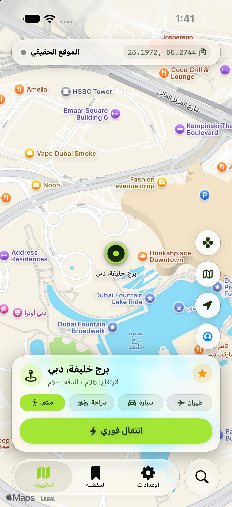
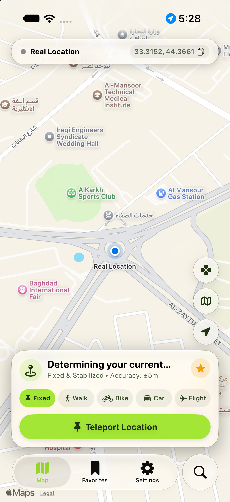

# Locanger 📍
### محاكي وتثبيت الموقع الجغرافي المتقدم لنظام iOS (بدون جيلبريك وبدون كمبيوتر)
**Next-Generation Jailed iOS Location Simulation Engine**

  
  
  
  

  

---

## 🌟 نظرة عامة | Overview

**Locanger** هو تطبيق احترافي متطور صُمم خصيصاً لتغيير وتثبيت ومحاكاة الموقع الجغرافي (GPS) على جميع أجهزة iPhone و iPad دون الحاجة إلى كسر حماية النظام (No Jailbreak)، وبدون الحاجة لربط الجهاز بالكمبيوتر أثناء الاستخدام اليومي.

يعتمد التطبيق على بروتوكول **Apple CoreDevice DDI** ونفق شبكة محلي آمن ومغلق (**Split-Tunnel Loopback VPN**) لتوجيه إحداثيات الموقع مباشرة إلى خدمات الموقع في النظام (`locationd`)، مما يجعله يعمل بسلاسة تامة وموثوقية عالية على جميع تطبيقات التواصل والخرائط والألعاب.

---

## 📸 لقطات الشاشة | Screenshots

  <table>
    <tr>
      <th width="33%">الوضع الليلي (Dark Mode)</th>
      <th width="33%">الوضع النهاري (Light Mode)</th>
      <th width="33%">English Interface</th>
    </tr>
    <tr>
      <td></td>
      <td></td>
      <td></td>
    </tr>
  </table>

---

## ✨ المميزات الرئيسية | Key Features

- 📍 **تثبيت الموقع والانتقال الفوري (Instant Teleportation)**: إمكانية اختيار أي نقطة في العالم بلمسة واحدة والانتقال إليها فوراً بدقة عالية تصل إلى $\pm 5$ أمتار.
- 🚶 **محاكاة الحركة الواقعية (Multi-Speed Simulation)**:
  - 🚶 **المشي (Walk)**: سرعة واقعية (1.2 م/ث - 4.3 كم/س).
  - 🚴 **الدراجة (Bike)**: سرعة متوسطة (4.5 م/ث - 16 كم/س).
  - 🚗 **السيارة (Car)**: سرعة قيادة واقعية (15.0 م/ث - 54 كم/س).
  - ✈️ **الطيران (Flight)**: سرعة تنقل فائقة للمسافات البعيدة (60.0 م/ث).
- 📶 **المساعد الخلوي الذكي (Cellular Assistant)**:
  - تقنية ذكية تتيح تثبيت الموقع الجغرافي بكفاءة متناهية حتى أثناء استخدام **بيانات الهاتف الخلوية (Cellular Data / 4G / 5G)** دون تضارب مع أبراج الاتصال.
  - واجهة إرشادية أنيقة ومباشرة ترشد المستخدم إلى الإجراء الصحيح بضغطة زر واحدة.
- 🕹️ **عصا التحكم التفاعلية (Floating Virtual Joystick)**:
  - عصا تحكم عائمة على الشاشة تتيح لك التحرك في جميع الاتجاهات بحرية وسلاسة داخل التطبيقات والألعاب.
- 🔒 **نفق محلي مشفر وآمن 100% (Local Split-Tunnel Loopback)**:
  - يعمل نفق الـ VPN داخلياً على عنوان الاسترجاع الذاتي للجهاز (`127.0.0.1`) فقط للتخاطب مع خدمات النظام، ولا يمرر أي بيانات إنترنت إلى أي خادم خارجي، مما يحافظ على الخصوصية الكاملة وسرعة الإنترنت الطبيعية.
- 🎨 **تصميم فخم بهوية Apple Liquid Glass**:
  - واجهات زجاجية ناعمة تدعم الوضعين الداكن (Dark Mode) والفاتح (Light Mode) بتباين بصري عالي ومريح للعين مع تناسق كامل مع لغة تصميم iOS الحديثة.
- 🌐 **دعم كامل للغتين العربية والإنجليزية (Bilingual Support)**.

---

## 📥 طرق التثبيت والتحميل | Installation Guide

يمكن تثبيت ملف **Locanger.ipa** على جهازك باستخدام أي من الطرق المعتمدة التالية:

### 1. TrollStore (الطريقة الموصى بها - iOS 14.0 إلى 17.0)
1. قم بتحميل ملف `Locanger.ipa` من قسم [Releases](https://github.com/alibusut/Locanger-App/releases/latest).
2. افتح الملف عبر تطبيق **TrollStore**.
3. اضغط على **Install**. سيعمل التطبيق بكامل صلاحياته ودون الحاجة لتجديد الشهادات كل 7 أيام.

### 2. AltStore / SideStore (بدون جيلبريك لجميع الإصدارات)
1. حمّل ملف `Locanger.ipa` على هاتفك.
2. افتح تطبيق **AltStore** أو **SideStore**.
3. انتقل إلى تبويب **My Apps** واضغط على علامة `+`.
4. اختر ملف `Locanger.ipa` وانتظر حتى تكتمل عملية التوقيع والتثبيت.

### 3. أدوات التوقيع الأخرى (Scarlet / LiveContainer / ESign)
- يدعم التطبيق التثبيت عبر الشهادات المؤسسية والمطورة باستخدام أدوات التوقيع المباشر بكل سهولة.

---

## 💡 كيفية استخدام التطبيق وتثبيت الموقع على البيانات الخلوية

1. **الخطوة الأولى**: افتح التطبيق وحدد المكان المطلوب على الخريطة (أو استخدم شريط البحث للعثور على أي مدينة أو معلم سياحي).
2. **الخطوة الثانية (في حال كنت متصلاً بالبيانات الخلوية)**:
   - اضغط على زر **تثبيت الموقع** أو **انتقال فوري**.
   - في حال ظهور نافذة **مساعد البيانات الخلوية**:
     1. أوقف تفعيل البيانات الخلوية مؤقتاً من مركز التحكم أو الإعدادات.
     2. عد للتطبيق واضغط **تثبيت الموقع**.
     3. أعد تشغيل البيانات الخلوية فوراً.
   - سيستمر الموقع ثابتاً في مكانه المحدد طوال فترة الاستخدام!
3. **التحكم بالسرعة والحركة**: يمكنك التبديل بين وضع الثبات أو المشي أو القيادة لتجربة حركة حية ومستمرة.

---

## 🛡️ الخصوصية والأمان | Privacy & Security

- التطبيق **لا يقوم بجمع أو إرسال أي بيانات شخصية** أو سجلات للمواقع الجغرافية إلى أي خوادم خارجية.
- جميع عمليات المحاكاة وتوليد الاتصال بالنفق المحلي تجري كلياً داخل معالج هاتفك الشخصي (`On-Device Processing`).

---

## 👨‍💻 المطور | Developer

تم تطوير وهندسة التطبيق بالكامل بواسطة **[Ali Latif (@alibusut)](https://github.com/alibusut)**.

---

  صُنع بكل إتقان واحترافية • Built with precision & passion for iOS

