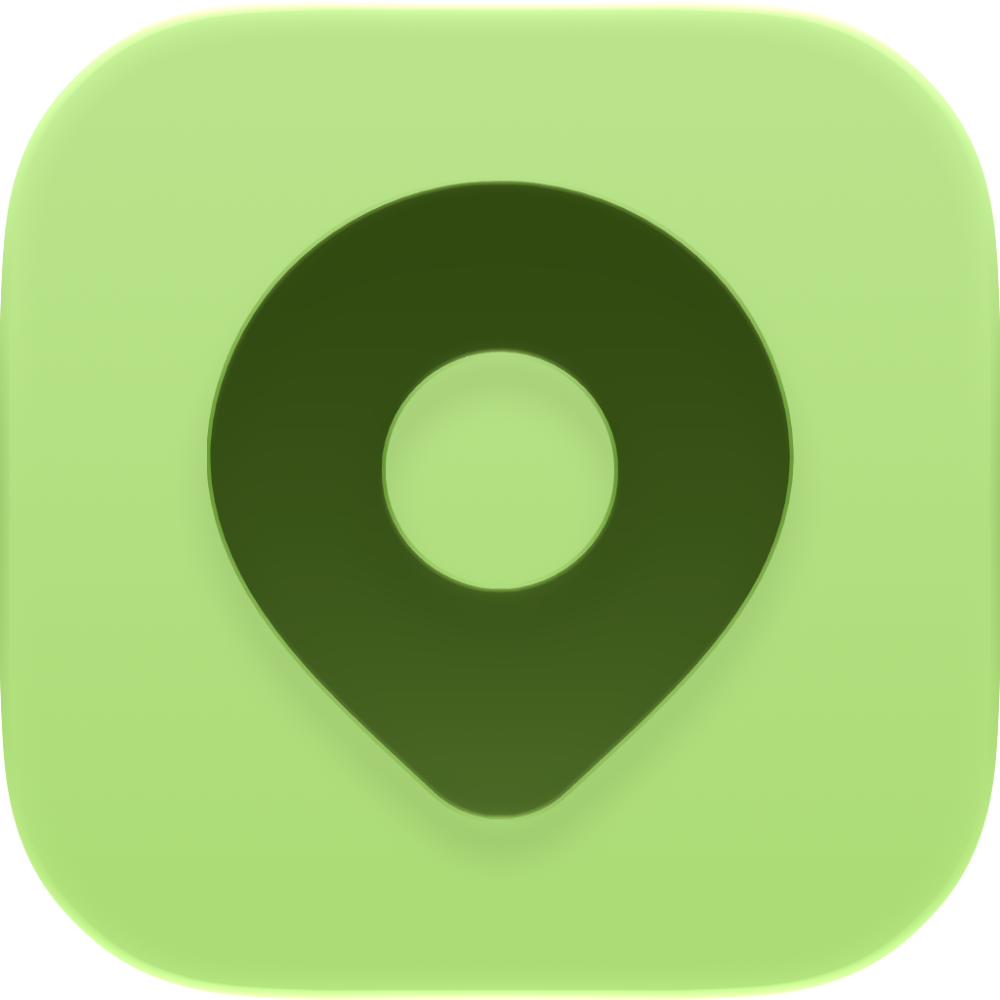
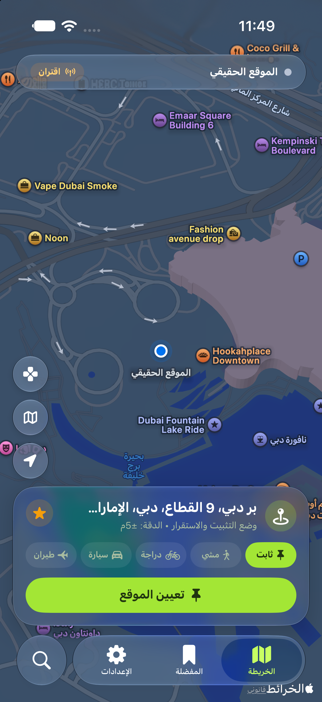
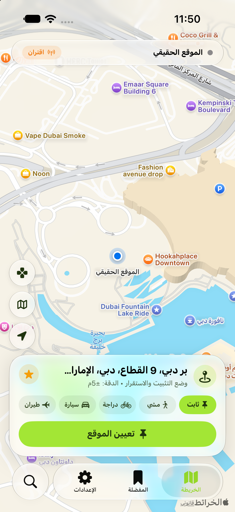
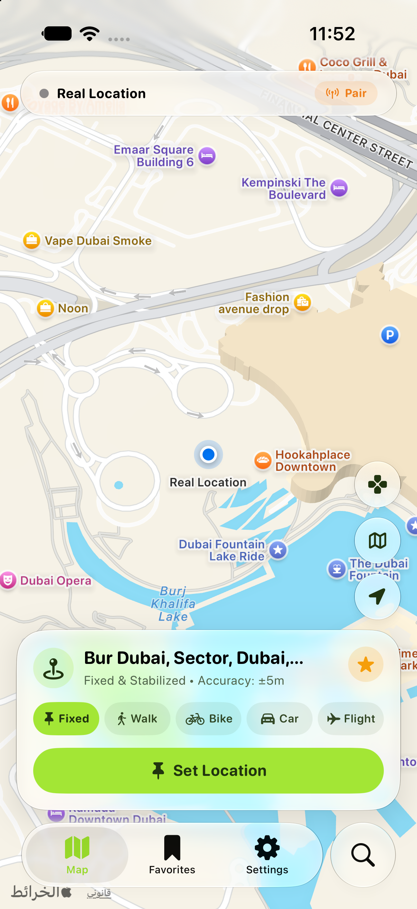

<div align="center">



# Locanger
### محاكي وتثبيت الموقع الجغرافي لنظام iOS بدون جيلبريك وبدون كمبيوتر
**Advanced Jailed iOS Location Simulation Engine**

<p align="center">
  <a href="https://appstar.store">
    
  </a>
  <a href="https://github.com/alibusut/Locanger-App/releases/latest">
    
  </a>
  
  
  
</p>

<p align="center">
  <a href="https://appstar.store">
    
  </a>
  &nbsp;
  <a href="https://github.com/alibusut/Locanger-App/releases/latest">
    
  </a>
</p>

</div>

---

<div dir="rtl">

### ◈ نظرة عامة

تطبيق **Locanger** هو نظام متطور وذاتي بالكامل لتغيير وتثبيت ومحاكاة إحداثيات الموقع الجغرافي (GPS) على جميع أجهزة iPhone و iPad، يعمل بكفاءة متناهية دون الحاجة لكسر حماية النظام (No Jailbreak)، وبشكل مستقل تماماً على جهازك دون الحاجة لربطه بجهاز كمبيوتر أثناء الاستخدام اليومي.

تم بناء التطبيق بالاعتماد على محرك **Locanger Core™** الذكي، والذي يوفر محاكاة واقعية فائقة الدقة تتكامل بسلاسة مع كافة تطبيقات الخرائط، والتواصل الاجتماعي، والألعاب العالمية.

</div>

---

<div align="center">

### ◈ واجهة التطبيق — Application Interface

<table>
  <tr>
    <th width="33%" align="center">الوضع الداكن (Dark Mode)</th>
    <th width="33%" align="center">الوضع الفاتح (Light Mode)</th>
    <th width="33%" align="center">English Interface</th>
  </tr>
  <tr>
    <td align="center"></td>
    <td align="center"></td>
    <td align="center"></td>
  </tr>
</table>

</div>

---

<div dir="rtl">

### ◈ المواصفات والمميزات

- **✦ تثبيت الموقع والانتقال الفوري (Instant Teleportation)**  
  اختيار وتحديد أي موقع في العالم بلمسة واحدة والانتقال إليه فوراً بدقة استقرار عالية تصل إلى ±5 أمتار.

- **✦ محاكاة السرعة المتعددة (Multi-Speed Motion Simulation)**  
  محاكاة حركة واقعية للمسارات مع أنماط سرعة متعددة:
  - **نمط المشي (Walk)**: سرعة واقعية (1.2 م/ث — 4.3 كم/س).
  - **نمط الدراجة (Bike)**: سرعة متوسطة (4.5 م/ث — 16.0 كم/س).
  - **نمط السيارة (Car)**: سرعة تنقل قيادة (15.0 م/ث — 54.0 كم/س).
  - **نمط الطيران (Flight)**: سرعة تنقل فائقة للمسافات البعيدة (60.0 م/ث).

- **✦ مساعد البيانات الخلوية (Cellular Assistant)**  
  نظام ذكي فريد يسمح بتثبيت إحداثيات الموقع بكفاءة واستقرار حتى أثناء الاتصال بشبكات الهاتف الخلوية (4G / 5G) دون تشتت الإشارة، عبر خطوات تهيئة مبسطة وسريعة.

- **✦ عصا التحكم الافتراضية العائمة (Floating Virtual Joystick)**  
  أداة تحكم عائمة وسلسة على الشاشة تتيح المناورة واستكشاف المحيط في جميع الاتجاهات بحرية تامة أثناء تشغيل التطبيقات الأخرى.

- **✦ أمان وخصوصية محلية 100% (Zero-Exposure Processing)**  
  تتم جميع عمليات المحاكاة داخلياً على معالج الجهاز دون إرسال أو توجيه أي بيانات خارج هاتفك، مما يحافظ على الخصوصية التامة وسرعة اتصالك الطبيعية.

- **✦ لغة تصميم Apple Liquid Glass**  
  واجهات مستخدم زجاجية مريحة للعين تدعم التباين العالي والتناغم اللوني الدقيق للوضعين الليلي والنهاري، مع دعم تلقائي كامل للغتين العربية والإنجليزية.

---

### ◈ طرق التثبيت

#### 1. التثبيت المباشر عبر متجر آب ستار (AppStar Store) — الطريقة الرسمية والموصى بها

> [!TIP]
> يوصى بتثبيت التطبيق مباشرة عبر **متجر آب ستار** للحصول على تثبيت فوري بضغطة زر واحدة، مع توقيع مستقر ودعم التحديثات المباشرة دون الحاجة لأجهزة كمبيوتر.

1. توجه إلى الموقع الرسمي للمتجر: **[appstar.store](https://appstar.store)**
2. ابحث عن تطبيق **Locanger** داخل المتجر.
3. اضغط على **تثبيت (Install)** لتنزيل التطبيق مباشرة على شاشتك الرئيسية والبدء باستخدامه فوراً.

---

#### 2. التثبيت اليدوي عبر ملف الـ IPA (Sideloading)

لمن يفضل تثبيت وتوقيع التطبيق يدوياً باستخدام أدوات التوقيع الخاصة:

1. حمّل ملف `Locanger.ipa` من [صفحة الإصدارات الرسمية](https://github.com/alibusut/Locanger-App/releases/latest).
2. افتح الملف عبر أداة التوقيع المفضلة لديك (مثل **AltStore**, **SideStore**, **ESign**, **Scarlet** أو أي أداة توقيع شخصية).
3. أتمم عملية التوقيع وسيظهر التطبيق على شاشتك الرئيسية.

---

### ◈ آلية تثبيت الموقع عند استخدام البيانات الخلوية

```
[تحديد الموقع المطلوب] ──▸ [إيقاف البيانات الخلوية مؤقتاً] ──▸ [الضغط على تعيين الموقع] ──▸ [إعادة تشغيل البيانات]
```

1. **الخطوة الأولى**: حدد النقطة المراد محاكاتها على الخريطة.
2. **الخطوة الثانية**: في حال كنت متصلاً ببيانات الهاتف الخلوية، قم بإيقاف البيانات الخلوية مؤقتاً من مركز التحكم.
3. **الخطوة الثالثة**: اضغط على زر **تعيين الموقع** (أو **انتقال فوري**).
4. **الخطوة الرابعة**: أعد تشغيل البيانات الخلوية. سيبقى الموقع ثابتاً ومستقراً طوال فترة الاستخدام.

---

### ◈ الأمان والخصوصية

> [!NOTE]
> معالجة الإحداثيات وتوجيهها تتم بالكامل على معالج الجهاز (**On-Device Processing**). التطبيق لا يتصل بأي خوادم خارجية ولا يجمع أي معلومات تتعلق بالهوية أو النشاط أو سجل المواقع.

</div>

---

<div align="center">
  <a href="https://appstar.store">
    
  </a>
  <br />
  <sub>متوفر رسمياً على <b><a href="https://appstar.store">متجر آب ستار (AppStar Store)</a></b></sub>
  <br />
  <sub>هندسة وتطوير: <b>Ali Latif (@alibusut)</b> • جميع الحقوق محفوظة</sub>
</div>
